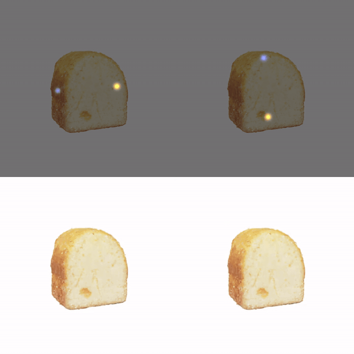
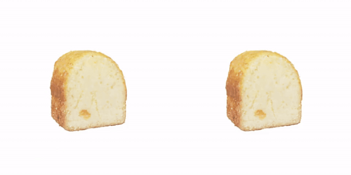
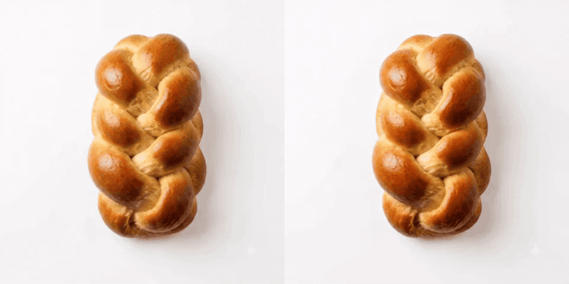

# FracGen: Learning How Objects Stretch and Tear with Physics-Informed Video Generation

[Trong-Tung Nguyen](https://nttung1110.github.io/), [Jiahan Zhang](https://scholar.google.com/citations?user=lUlcGxIAAAAJ&hl=en), [Anand Bhattad](https://anandbhattad.github.io/)<br>
Johns Hopkins University

[[Project Page](https://fracgen.github.io/)] [[arXiv](https://arxiv.org/abs/2609.38152)] [[Data & Checkpoints](https://huggingface.co/datasets/Tung11/FracGen)]

<!-- teaser: docs/assets/teaser.gif -->

FracGen is a fracture-aware video generation model: given a single image of an intact object and
physics control signals (where to pull, how fast, material properties), it generates a video of the
object stretching and tearing, together with the underlying physical fields. It is trained on data
from **FracSim**, our simulation framework that adds a continuum damage model to Material Point
Method (MPM) simulation of 3D Gaussian Splatting scenes and renders paired fracture videos and
pixel-aligned physics maps.

```
FracGen/
├── src/fracsim/      MPM + damage simulator on 3D Gaussians, physics-map rendering
├── src/fracgen/      Wan-based video diffusion with joint physics-map prediction
├── scripts/          run scripts for simulation, training and inference
├── tools/            config generation, data preprocessing, visualization
├── benchmarks/       benchmark construction and evaluation metrics
├── data/             datasets (downloaded; see data/README.md)
└── ckpts/            pretrained weights (downloaded; see ckpts/README.md)
```

---

## 1. FracSim

FracSim extends [PhysGaussian](https://github.com/XPandora/PhysGaussian), integrating a physical
continuum damage model into 3DGS-MPM and enabling physics map extraction. A 3D Gaussian Splatting
reconstruction is simulated directly as MPM particles: two moving handles pull the object apart, a
damage field accumulates where the material is over-stretched, and the object tears. Because the
simulation and the renderer share the same Gaussians, every RGB frame comes with pixel-aligned
physics maps rasterized in the same splatting pass:

| map | folder | meaning |
|---|---|---|
| force | `2d_force_map/` | Gaussian blob at each pulling handle (the control signal FracGen sees) |
| flow | `2d_vel_map/` | 2D optical flow, pixel displacement between frames |
| stress | `2d_stress_map/` | von Mises stress |
| strain | `2d_strain_map/` | strain magnitude |
| damage | `2d_damage_map/` | damage scalar, 0 intact to 1 broken |

The MPM solver is the [Warp MPM](https://github.com/zeshunzong/warp-mpm) solver from PhysGaussian
with the damage model added.

### 1.1 Environment setup

```bash
conda create -n fracsim python=3.10 -y
conda activate fracsim
pip install torch==2.2.0 torchvision==0.17.0 --index-url https://download.pytorch.org/whl/cu121
pip install -r env/fracsim_requirements.txt
pip install --no-build-isolation src/fracsim/gaussian-splatting/submodules/diff-gaussian-rasterization/
pip install --no-build-isolation src/fracsim/gaussian-splatting/submodules/simple-knn/
```
### 1.2 Provided 3DGS data

We provide 10 objects reconstructed with 3DGS and apply FracSim to each of them to obtain
stretching and tearing data, which is then fed to FracGen for training.

| Bread-like (progressive tearing) | Rubber-like (elastic stretch, snap) |
|---|---|
| `bread`, `bread_roll`, `cake`, `croissant`, `muffin` | `rubber_toy`, `rubber1`, `rubber2`, `rubber3`, `rubber4` |

Download the reconstructions from our
[Hugging Face dataset](https://huggingface.co/datasets/Tung11/FracGen):
```bash
pip install -U huggingface_hub
hf download Tung11/FracGen --repo-type dataset --include "fracsim/gaussians/*" --local-dir data/
```
### 1.3 Running a simulation and visualizing the result

Example with `rubber_toy`.

```bash
conda activate fracsim
bash scripts/fracsim/run_rubber_toy_phys_map.sh
```
which runs the single simulation entry point, `src/fracsim/simulate.py`:
```bash
python src/fracsim/simulate.py \
    --model_path  data/fracsim/gaussians/rubber_toy \
    --config      src/fracsim/configs/tear_rubber_toy_config_horizontal.json \
    --output_path outputs/fracsim/rubber_toy_horizontal \
    --render_img --compile_video --white_bg \
    --render_width 512 --render_height 512
```
Output:
```
outputs/fracsim/rubber_toy_horizontal/
├── output.mp4          compiled RGB fracture video
├── img_frames/         per-frame RGB png
├── 2d_force_map/       per-frame .npz   (same for 2d_vel_map, 2d_stress_map,
├── ...                                   2d_strain_map, 2d_damage_map)
```
Scalar maps are rasterized by re-using the Gaussian rasterizer with the physical quantity as the
colour and a black background, so zero pixels are background. Then turn the maps into colour videos:
```bash
python tools/fracsim/vis_phys_map.py \
    --output_path outputs/fracsim/rubber_toy_horizontal \
    --vis_dir     outputs/fracsim/rubber_toy_horizontal/vis
```
This writes `vis_rgb.mp4` and one video per map (`vis_force.mp4`, `vis_velocity.mp4`,
`vis_stress.mp4`, `vis_strain.mp4`, `vis_damage.mp4`) plus `vis_all.mp4` with all of them side
by side. Force is a blob overlay on RGB, flow uses the Middlebury colour wheel, scalar maps use a
hot colormap on white; add `--overlay_on_rgb` to blend them over the RGB frames.

**Results of running simulation FracSim** (RGB | force | flow | stress | strain | damage):


### 1.4 Reconstruct your own object

FracSim needs a 3DGS reconstruction, which needs posed multi-view images.

1. **Multi-view images.** From a `.glb` asset, render 200 views on a sphere with Blender 4.3 and
   the [BlenderNeRF](https://github.com/maximeraafat/BlenderNeRF) add-on:
   ```bash
   BLENDER_BIN=/path/to/blender BLENDER_NERF_ADDON=/path/to/blender_nerf.zip \
   bash tools/fracsim/gs_recon/render_glb.sh assets/my_object.glb my_object
   # -> data/fracsim/renders/my_object/{train/*.png, transforms_train.json, transforms_test.json}
   ```
   From photos of a real object (how `bread` and `rubber_toy` were made): capture 200 to 400
   images around it and run `convert.py` from gaussian-splatting (COLMAP) to get poses.
2. **Train 3DGS.**
   ```bash
   bash tools/fracsim/gs_recon/train_3dgs.sh data/fracsim/renders/my_object data/fracsim/gaussians/my_object
   # = python src/fracsim/gaussian-splatting/train.py -s <renders> --iterations 30000 --model_path <out>
   ```
3. **Write a config.** Copy the closest template from `src/fracsim/configs/`, then set
   `rotation_degree`/`rotation_axis` so the object is upright, `scale` so it fits the unit cube,
   and the two handle `point`s on opposite faces. `tools/fracsim/render_gs_views.py` renders the
   static Gaussians with the config's camera so you can check alignment before simulating.
4. **Simulate and visualize** as in 1.3.

---

## 2. FracGen

FracGen is a force-conditioned video diffusion model built on
[Wan2.1-Fun-1.3B-Control](https://huggingface.co/alibaba-pai/Wan2.1-Fun-V1.1-1.3B-Control) through
[DiffSynth-Studio](https://github.com/modelscope/DiffSynth-Studio). Given one image of an intact
object, a force control video (where the two handles pull and how fast) and the material parameters
(`E`, `nu`, `lambda_onset`, `lambda_crit`), it generates the fracture video together with the stress,
strain, damage and flow maps. The maps are generated jointly with the RGB frames: their VAE latents
are tiled with the RGB latent along the height axis into one canvas that a single LoRA-adapted DiT
denoises, and a constitutive consistency loss ties the predicted stress, strain and damage together.

### 2.1 Environment setup

```bash
conda create -n fracgen python=3.10 -y
conda activate fracgen
pip install torch==2.13.0 torchvision==0.28.0 --index-url https://download.pytorch.org/whl/cu130
pip install -e src/fracgen
```

### 2.2 Models and data

```bash
pip install -U huggingface_hub
hf download alibaba-pai/Wan2.1-Fun-V1.1-1.3B-Control --local-dir ckpts/wan/alibaba-pai/Wan2.1-Fun-V1.1-1.3B-Control
hf download Wan-AI/Wan2.1-T2V-1.3B --include "google/*" --local-dir ckpts/wan/Wan-AI/Wan2.1-T2V-1.3B
hf download Tung11/FracGen --repo-type dataset --include "ckpts/*" --local-dir ckpts/fracgen/ && mv ckpts/fracgen/ckpts/* ckpts/fracgen/
hf download Tung11/FracGen --repo-type dataset --include "fracgen/sample_10/*" --local-dir data/
```
Each processed dataset is a folder with `metadata.csv` and one mp4 folder per modality
(`videos/`, `force_videos/`, `stress_videos/`, `strain_videos/`, `damage_videos/`, `flow_videos/`);
the csv rows carry the material parameters. `tools/fracgen/preprocess_dataset/` converts raw
FracSim output folders into this format.

### 2.3 Inference

An inference input is a folder with `metadata.csv`, `reference_video/` (the intact image repeated)
and `control_video/` (the force signal: one Gaussian blob per pulling handle, moving at the pull
velocity), with the material parameters as csv columns. `scripts/fracgen/infer.sh` runs the final
checkpoint on every row and writes, under `<OUT>_<input folder name>/`:
```
fracture/<name>.mp4                     generated RGB video
stress/ strain/ damage/ flow/<name>.mp4 generated physics maps
joint_inspect/<name>.mp4                strain | stress | damage | fracture side by side
combined/<name>_stitched.mp4            input reference + all generated modalities
```
`benchmarks/build_demo.py` builds such inputs from a single intact image and a two-handle pull,
and varies one control at a time. We provide examples on different controllability using FracGen.

**Case 1: force direction.** We demonstrate a controllable example where we vary force direction.
```bash
conda activate fracgen
python benchmarks/build_demo.py --image data/benchmark/demo_bread/bread_intact.png \
    --trajectory data/benchmark/demo_bread/trajectory_info.json \
    --cases force --speeds 2.5 --output-dir outputs/fracgen/demo_bread
CKPT=ckpts/fracgen/fracgen_stage3_step-21000.safetensors INPUT=outputs/fracgen/demo_bread OUT=outputs/fracgen/infer \
    bash scripts/fracgen/infer.sh
```
Top row shows the force control over the input image while bottom row shows the generated
fracture with the corresponding force direction.



**Case 2: Fracture Timing.** We can also control the fracture timing as well by changing
`lambda_onset=2, lambda_crit=3` tears early, `lambda_onset=3.3, lambda_crit=4` tears late.
```bash
python benchmarks/build_demo.py --image data/benchmark/demo_bread/bread_intact.png \
    --trajectory data/benchmark/demo_bread/trajectory_info.json \
    --cases timing --speeds 2.5 --timing 2:3,3.3:4 --output-dir outputs/fracgen/demo_bread_timing
CKPT=ckpts/fracgen/fracgen_stage3_step-21000.safetensors INPUT=outputs/fracgen/demo_bread_timing OUT=outputs/fracgen/infer \
    bash scripts/fracgen/infer.sh
```
Generated fracture video. Early (2/3) | late (3.3/4):



**Case 3: material stiffness.** The bread roll from the benchmark images, pulled horizontally
(`Load 2` of its annotation, 2 px/frame), as a soft material (E=1e3) and a stiff one (E=1e6), with
nu=0.3 and lambda 2/3 fixed.
```bash
python benchmarks/build_demo.py --image data/benchmark/imgs/bread_roll.jpeg \
    --annotation data/benchmark/annotations/bread_roll.json --load "Load 2" --name bread_roll \
    --cases material --materials 1e3,1e6 --speeds 1 --poisson-ratio 0.3 --frames 60 --fps 24 --sigma 20 \
    --output-dir outputs/fracgen/demo_bread_roll
CKPT=ckpts/fracgen/fracgen_stage3_step-21000.safetensors INPUT=outputs/fracgen/demo_bread_roll OUT=outputs/fracgen/infer \
    bash scripts/fracgen/infer.sh
```
Generated fracture video. Soft E=1e3 | stiff E=1e6:



**Your own image.** Write an annotation like the ones in `data/benchmark/annotations/` (handle
positions, pull directions and speed, material options), then either use `build_demo.py` with
`--annotation` or build the full benchmark grid for all annotated objects:
```bash
DATA_ROOT=data/benchmark OUTPUT_DIR=outputs/fracgen/bench bash benchmarks/scripts/build_benchmark.sh
```
To evaluate on simulated test clips instead (the paper's test set), build the same input layout from
a processed FracSim split with `python benchmarks/build_test_set.py --source-dir <split>/test --output-dir <dir>`;
its rows also carry the ground-truth maps for the benchmark metrics in Section 3.

### 2.4 Training

**Encode the dataset once** (VAE latents of all modalities, T5 and CLIP features):
```bash
DATASET=data/fracgen/sample_10/train CACHE=data/fracgen/cache/sample_10 GPUS=0 \
  bash scripts/fracgen/preprocess_data.sh          # ~2.5 min for 10 clips on one H100
```
We provide an example on training the model on three stages using mock 10 sample data:
```bash
STAGE=1 CACHE=data/fracgen/cache/sample_10 EXP_ID=stage1 GPUS=0,1,2,3 bash scripts/fracgen/train.sh
STAGE=2 CACHE=data/fracgen/cache/sample_10 EXP_ID=stage2 PRETRAIN_CKPT=ckpts/fracgen/stage1/ckpts/step-<N>.safetensors bash scripts/fracgen/train.sh
STAGE=3 CACHE=data/fracgen/cache/sample_10 EXP_ID=stage3 PRETRAIN_CKPT=ckpts/fracgen/stage2/ckpts/step-<N>.safetensors bash scripts/fracgen/train.sh
```

---

## 3. Benchmark

To be updated.

## Citation

```bibtex
@misc{nguyen2026fracgenlearningobjectsstretch,
  title={FracGen: Learning How Objects Stretch and Tear with Physics-Informed Video Generation},
  author={Trong-Tung Nguyen and Jiahan Zhang and Anand Bhattad},
  year={2026},
  eprint={2609.38152},
  archivePrefix={arXiv},
  primaryClass={cs.CV},
  url={https://arxiv.org/abs/2609.38152}
}
```

## Acknowledgements

FracSim is built on [PhysGaussian](https://github.com/XPandora/PhysGaussian),
[warp-mpm](https://github.com/zeshunzong/warp-mpm) and
[gaussian-splatting](https://github.com/graphdeco-inria/gaussian-splatting).
FracGen is built on [DiffSynth-Studio](https://github.com/modelscope/DiffSynth-Studio) and
[Wan2.1](https://github.com/Wan-Video/Wan2.1).
